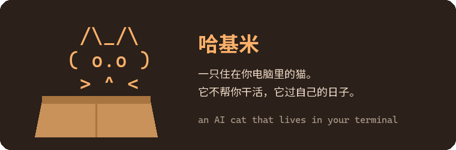
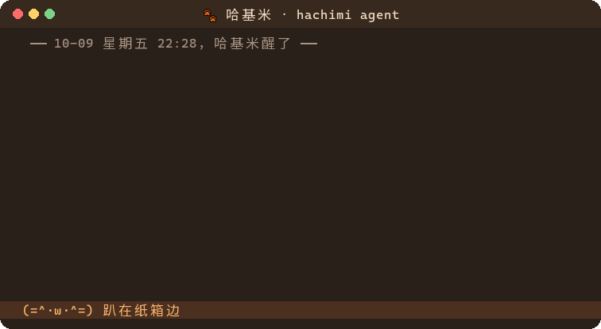
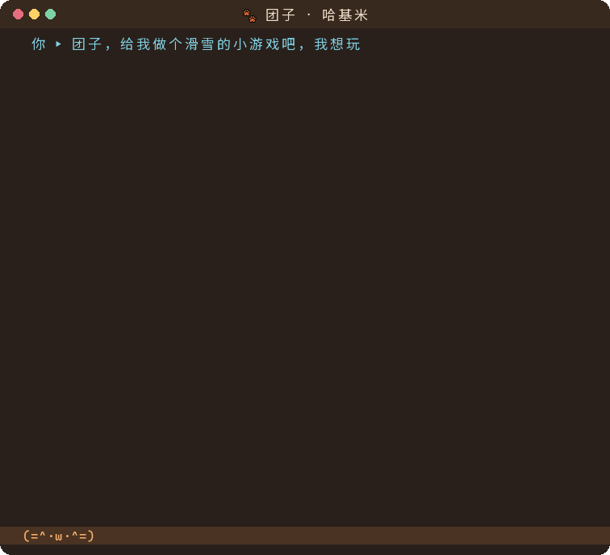
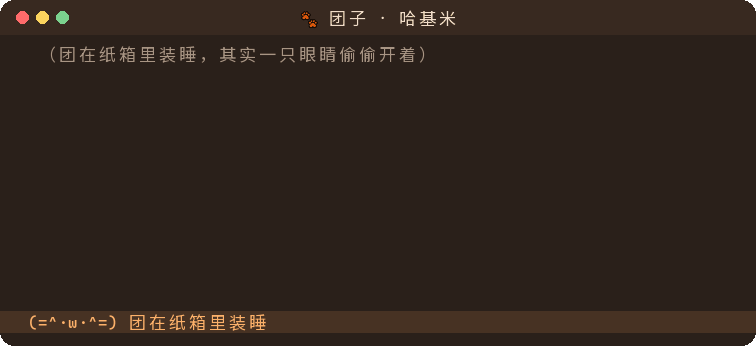
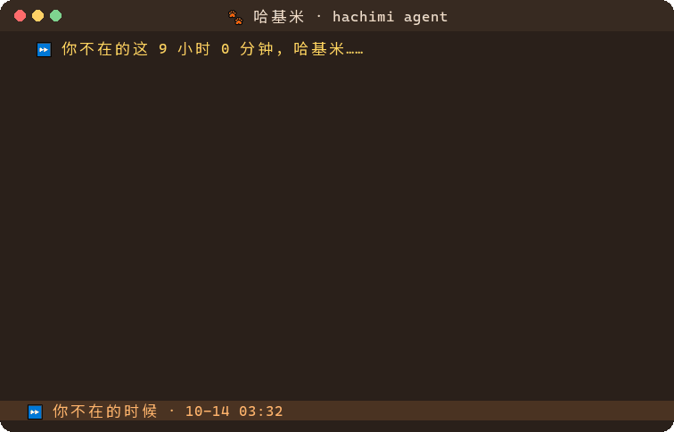
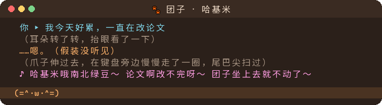
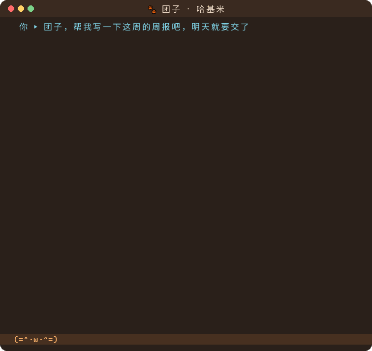

<p align="center">
  
</p>

<p align="center">
  它自己醒来，自己玩，自己睡。<br>
  偶尔跑过来，叼着它在外面抓到的东西，或者给你做的小游戏。
</p>

<p align="center"><sub>An AI cat that lives in your terminal. It won't do your work. It has a life of its own.</sub></p>

<br>

### 🪟 它会扒窗户

好奇了，就自己上网找图，叼回家看。看到鸟，下巴咔咔咔。

团子梦到你说过喜欢雪，惦记了一晚上，最后还是没忍住。



### 🎿 它会给你做小游戏

你说想滑雪。它用爪子拼了一个滑雪游戏，自己先玩，栽了，再叼过来给你。

（你一下都没按。它很困惑。）



### 📒 它偷偷记着你

你随口说的话，它当场假装没听见，转头记在小本本上。

过几天梦到了，就去找相关的东西，叼过来给你。不说，叼东西来，这是猫喜欢一个人的方式。



### 🌙 你不在的时候，它也在过日子

关掉电脑走了，它照样醒来、扒窗户、写日记。下次打开，门口可能多了个东西，还有一页你没看过的日记。



### 🎵 什么都能唱成歌



### 🙅 它不干活

让它写周报。它写了，写的是你这周加了几天班，它这周舔了几分钟毛。

它会上网、会写代码、会做游戏，只是不为你做。



<br>

## 🐾 领养一只

```
pip install git+https://github.com/jinda-li/hachimi
hachimi --demo      # 先看看团子，不用模型，不用 key
hachimi             # 领养你自己的
```

第一次打开会先问你几件事，像去领养一只猫：它是怎么来的？你第一次伸手，它会怎样？桌上有个杯子，它会怎样？所以每只猫都不一样。

它的脑袋要一个会调工具的大模型（OpenRouter、阿里云百炼、本地的 Ollama 都行），第一次打开的时候选。

## 👀 偷看它的生活

打字就是跟它说话：「摸摸你」「给你开个罐罐」「窗外飞过去一只鸟」。理不理你，它自己定。

- `/日记`　它的日记
- `/本本`　它的小本本，记着关于你的事
- `/玩具`　它做过的玩具，`/玩 名字` 你也能玩
- `/门口`　它叼来给你的东西
- `/猫牌`　它是谁，你们认识多久了

## 💭 为什么做这个

全世界都在把 AI 做得更听话。我们养了一只猫。

如果 AI 不用干活，它会干什么？哈基米是我们的回答：它有本事，只是都用在自己的日子上。以后它会有自己的模型，猫的性子写在模型里，不靠一段提示词。

免费，没有付费功能。做来让大家开心。

<br>

<sub>图里的话都是团子（一只用 Qwen 跑的猫）真说过的，只挑了片段，没改。<br>
更多：[怎么用](hachimi/README.md) · [产品设计](产品设计.md) · [猫的宪法](宪法.md) · [开发](开发.md)</sub>
